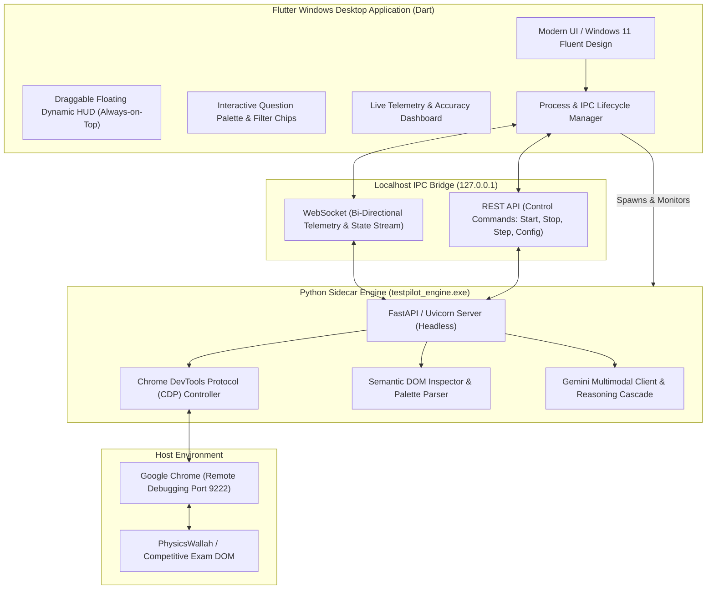
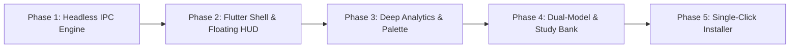

# TestPilot: Flutter Windows Desktop & UI/UX Architectural Roadmap

> **Target Vision**: Transform **TestPilot** from a local web dashboard into an ultra-premium, native Windows desktop application powered by **Flutter** for the frontend and a high-performance **Python Sidecar Engine** for browser automation, CDP control, and Gemini Vision AI.

---

## 1. Architectural Blueprint: Flutter + Python Sidecar

The recommended architecture separates the presentation layer (Flutter Desktop) from the automation and reasoning engine (Python). This pattern—widely used by apps like Docker Desktop and GitKraken—delivers high framerate native UI while retaining Python's browser control and AI ecosystem.



---

## 2. Process Lifecycle & IPC Specification

### Process Management
1. **Startup**: When the Flutter app launches, it checks if `testpilot_engine.exe` is already running. If not, it executes `Process.start('testpilot_engine.exe', ['--port', '8000', '--headless'])`.
2. **Heartbeat & Health Checks**: Flutter polls `GET http://127.0.0.1:8000/api/status` until the sidecar reports ready (`HTTP 200`).
3. **Graceful Shutdown**: When the Flutter window is closed (`window_manager` close event), Flutter sends `POST /api/shutdown` or terminates the sidecar process tree cleanly to prevent orphaned background tasks.

### Real-Time WebSocket Communication
Instead of HTTP polling, a WebSocket channel (`ws://127.0.0.1:8000/ws/telemetry`) streams events in real time:

```json
// Example Event: State Update
{
  "event": "QUESTION_SOLVED",
  "data": {
    "question_index": 7,
    "total_questions": 20,
    "answered_count": 6,
    "remaining_count": 13,
    "predicted_answer": "B",
    "confidence": "HIGH",
    "latency_seconds": 1.74,
    "reasoning": "Statement 1 is correct... Statement 2 is invalid...",
    "palette_state": {
      "answered": [1, 2, 3, 5, 6, 7],
      "not_answered": [4],
      "current": 8
    }
  }
}
```

---

## 3. Native Windows 11 UI/UX Design System

### Visual Language
- **Fluent Design & Mica/Acrylic Material**:
  - Leverage [`flutter_acrylic`](https://pub.dev/packages/flutter_acrylic) and [`fluent_ui`](https://pub.dev/packages/fluent_ui) for authentic Windows 11 window styling, translucent sidebar blurs, and native title bars.
- **Micro-Interactions**:
  - 120Hz smooth transitions for question step navigation.
  - Haptic visual feedback on option confirmation (pulsing subtle green ring upon DOM verification).
  - Modern typography hierarchy using Segoe UI Variable / Inter.

### Window Modes
The application should support two interchangeable layout modes:
1. **Full Workspace Mode (Dashboard & Deep Analytics)**:
   - For pre-exam setup, API key management, reviewing previous tests, and reading step-by-step solutions.
2. **Companion Floating HUD Mode ("Mini Dynamic Island")**:
   - A compact, frameless, draggable, always-on-top pill (`bitsdojo_window` or `window_manager`) that sits over the Chrome browser window, taking up minimal screen real estate.

```
┌────────────────────────────────────────────────────────┐
│  🟢 TestPilot  |  Q#8 / 20  |  Choice: [ B ]  |  1.7s   │ [ ⏸ Pause ] [ ⏭ Step ]
└────────────────────────────────────────────────────────┘
```

---

## 4. UI/UX Feature Enhancements

### A. Live Question Stem & Split-Pane Inspector
- **High-DPI Stem Viewer**: Render the captured question stem with pinch-to-zoom, pan, and inverted contrast mode for low-light legibility.
- **OCR Text Extraction Overlay**: Toggle an inline OCR overlay showing extracted text alongside the raw question image for instantaneous verification.
- **Reasoning Breakdown Card**: Syntax-highlighted mathematical formulas and clear multi-statement truth tables ($S_1$: TRUE, $S_2$: FALSE).

### B. Interactive DOM Question Palette
- **Live Tile Grid**: Mirror the exam portal's palette in real time with color-coded states:
  - 🟢 **Answered** (Green)
  - 🔴 **Not Answered / Visited** (Red)
  - 🟣 **Marked for Review** (Purple)
  - ⚪ **Not Visited** (Light Slate)
- **1-Click Navigation**: Clicking a tile in Flutter issues a command to the sidecar to navigate to that question in the browser DOM.

### C. Live Performance & Section Analytics
- **Section Timers**: Real-time breakdown of time spent per section (e.g., Economy, Polity, Current Affairs).
- **Confidence vs. Accuracy Gauge**: Track the model's confidence distribution (High/Medium/Low) against solved questions.
- **Pacing Speedometer**: Visual indicator showing if answering rate complies with target pacing (e.g., 45s per question) to avoid anti-cheat velocity flags.

### D. Smart Humanized Pacing Engine
- **Non-Linear Randomization**: Replace fixed delay timers with a Gaussian human-pacing algorithm:
  - Longer simulated reading time for multi-statement / reading-heavy stems.
  - Shorter pacing for direct single-fact questions.
  - Micro-mouse movements simulated via CDP prior to option click.

### E. Multi-Agent Verification (Dual-Model Consensus)
- For high-stakes or low-confidence questions:
  - Query a secondary model (`gemini-2.0-flash` or `gemini-1.5-pro`) concurrently.
  - If both agree $\rightarrow$ auto-submit.
  - If they disagree $\rightarrow$ flag visually on the HUD for human confirmation.

### F. Historical Question Bank & Study Mode
- **Persistent Local Database** (SQLite via `drift` in Flutter):
  - Store solved questions, full reasoning, and timestamps locally.
- **Export Capabilities**:
  - Export test summary with solutions to clean PDF or Markdown study sheets.
  - Filter past mistakes for targeted revision.

---

## 5. Technology Stack Recommendations

| Component | Library / Framework | Purpose |
| :--- | :--- | :--- |
| **Frontend Framework** | **Flutter Desktop (Windows)** | Cross-platform, high-performance 120 FPS native UI |
| **Windows Styling** | `fluent_ui` + `flutter_acrylic` | Native Windows 11 Fluent Design & Mica transparency |
| **Window Control** | `window_manager` | Frameless, draggable, always-on-top floating HUD |
| **Local Storage** | `drift` (SQLite) | Offline test history, question bank, and configuration |
| **Charts & Graphs** | `fl_chart` | Interactive accuracy and latency visualizations |
| **IPC Client** | `web_socket_channel` + `http` | Low-latency communication with Python sidecar |
| **Backend Engine** | **Python (FastAPI + Uvicorn)** | Headless daemon running Playwright & Gemini Vision |
| **Packaging** | **Inno Setup / MSIX** | Single-file Windows installer bundling Flutter + Python |

---

## 6. Implementation Roadmap (Phase by Phase)



### Phase 1: Headless Python Engine & WebSocket Adapter
- Add `/ws/telemetry` WebSocket endpoint to [`dashboard.py`](../dashboard.py).
- Build a lightweight `engine_main.py` entry point that runs without browser auto-open.
- Verify CLI control commands (`start`, `stop`, `step`, `set_model`, `set_pacing`).

### Phase 2: Flutter Desktop Shell & Floating HUD
- Initialize Flutter Windows project (`flutter create --platforms=windows testpilot_ui`).
- Implement `window_manager` for smooth switching between Full Mode and Mini HUD Mode.
- Connect WebSocket client with automatic reconnect resilience.

### Phase 3: Interactive Palette & Rich Visuals
- Build the real-time Question Palette component mirroring PW's grid.
- Integrate stem image preview with pan/zoom.
- Add live latency and confidence gauges.

### Phase 4: Offline Question Bank & Smart Pacing
- Store every processed question in local SQLite.
- Implement Gaussian pacing delay to mimic human behavior.
- Add PDF/Markdown revision sheet generator.

### Phase 5: Production Packaging
- Compile Python backend to `bin/engine/testpilot_engine.exe` via PyInstaller.
- Bundle Python executable within Flutter's Windows build output folder (`build/windows/runner/Release/`).
- Create an automated **Inno Setup script** to produce a single `TestPilotSetup.exe` installer for end users with zero prerequisite installations.
